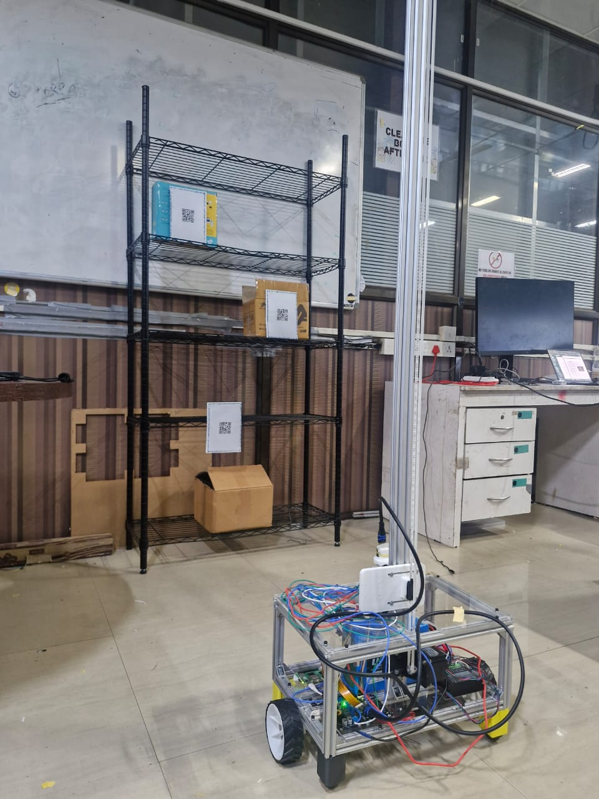
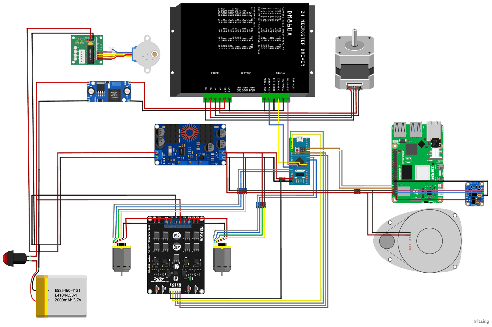

# Autonomous Warehouse Inventory Rover

An autonomous rover for warehouse inventory. It builds a map with lidar SLAM, navigates with Nav2
on ROS 2 and reads the QR codes on the racks.

Inter IIT Tech Meet 14.0, IIT Patna, Oct 2025 to Dec 2025. I was the Problem Statement Lead for
the Eternal (Zomato) problem statement, in a 33-member IIT Bombay team.

  

<em>Photo: the rover with its 1.5 m Z-axis mast, beside a test rack with QR codes.</em>

## What I did

- **Team.** I coordinated the 33-member team across mechanical design, computer vision, SLAM and
  navigation. I led IIT Bombay's in-person contingent for the final presentation and the live
  rover run.
- **Chassis.** I designed the differential-drive chassis. It has a 20 × 20 mm aluminium T-slot
  frame and a 5 mm acrylic deck. It is 44 × 29 cm and weighs 1.95 kg.
- **Z-axis mast.** I designed a 1.5 m Z-axis mast. A stepper motor drives a camera carriage on a
  GT2 belt. The carriage travels 1.35 m, from 0.25 m to 1.60 m above the floor, with about 2 to
  3 mm vertical repeatability.
- **Localisation.** I built an EKF that fuses depth, wheel odometry and the IMU. The racks serve as
  visual landmarks to cut odometry drift.
- **Navigation.** I set up the ROS 2 navigation stack. SLAM runs on a YDLiDAR X2 2D lidar with an
  8 m range. Nav2 uses the NavFn global planner and the MPPI controller.
- **Testing.** I validated the navigation with the team under varied conditions.

Other members of the team did the computer vision.

## Wiring (team drawing)

The team's wiring diagram, drawn in Fritzing. It shows the Raspberry Pi 5 with its camera, an STM32
board, the Z-axis stepper motor and its driver, a small stepper motor, the two drive motors and
their motor driver, the lidar, an IMU and the emergency stop button. Some parts are stand-ins. The
battery, for example, is drawn as a 3.7 V cell.

## Results

- IIT Bombay's team placed **2nd among 23 IITs**.
- In real tests the full system decoded **90%+** of the rack QR codes.
